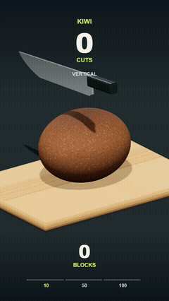

# 切割解压视频 Skill

用本地 3D 渲染制作竖屏 ASMR 切割视频。每一档从完整物体开始，先竖切，再横切，最后换方向竖切成块。刀数、碎块计数和刀声随画面同步。

## 演示

[](demo.mp4)

[查看完整演示 MP4](demo.mp4) · 19.6 秒，720 × 1280，有声。样片依次演示 10、50、100 刀。

## 用法

让 Codex 读取 [SKILL.md](SKILL.md)，告诉它物体、切刀档位和每档时长。例如「用这个 Skill 做一个猕猴桃切 10、50、100 刀的竖屏视频」。

支持猕猴桃、火龙果和肥皂三个内置预设。模型与音效在本地生成。水果块数来自三轴网格估算，高刀数时画面会降低碎块渲染密度。

## Instagram 自动发布程序

支持自动生成视频、可配置每日发布时间、SQLite 排期，以及浏览器 GUI 或官方 API 发布 Reels。默认浏览器模式固定使用 Microsoft Edge，无需 API token。首次在 `publisher.json` 填写 `browser.expectedUsername`，双击 `login-instagram.cmd` 手动登录，再双击 `start-publisher.cmd` 启动排期发布。账号未准备好时也可试运行。快速开始：

```powershell
node scripts/publish.mjs init
node scripts/publish.mjs doctor
node scripts/publish.mjs plan
node scripts/publish.mjs prepare
node scripts/publish.mjs status
```

账号接入、正式运行与 Windows 定时任务见 [自动发布说明](AUTOPUBLISH.md)。默认只试运行，显式 `run --live` 才会发布。

### 命令行

Windows 需要 Node.js、FFmpeg 和 Chrome 或 Edge。首次安装渲染依赖：

```powershell
$renderDeps = Join-Path $env:LOCALAPPDATA 'guiji-cutting-renderer'
npm.cmd install --prefix $renderDeps --no-audit --no-fund --ignore-scripts --save-exact three@0.187.0 playwright-core@1.65.1
```

在仓库根目录用样片配置重新生成视频：

```powershell
node scripts/render.mjs kiwi.json kiwi.mp4
```

可调整的设置见 [Skill 文档](SKILL.md)。

